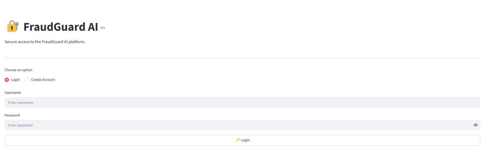
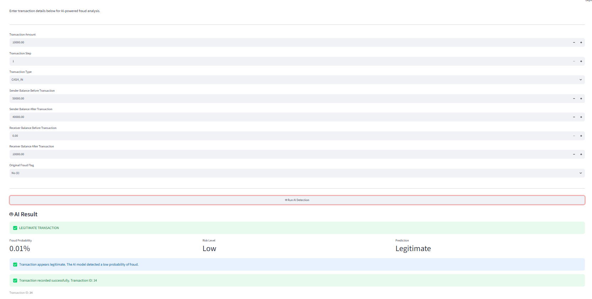
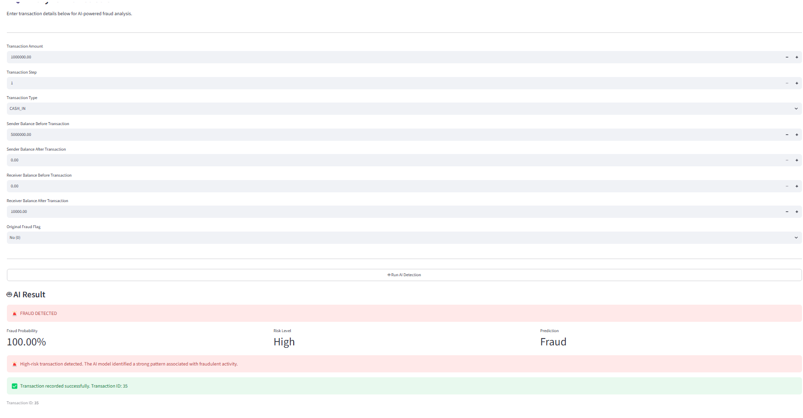
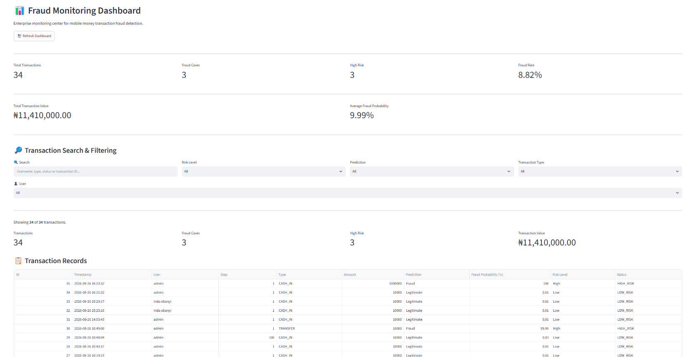
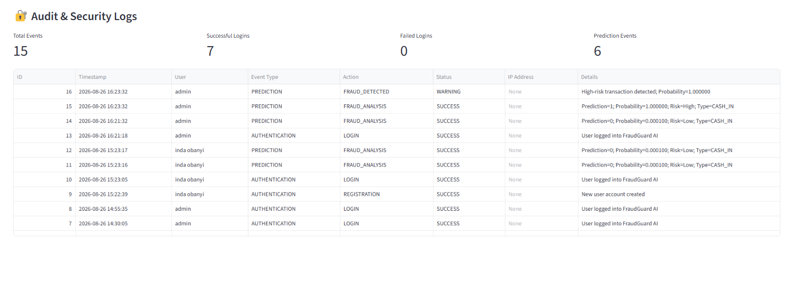

# 🛡️ FraudGuard AI

## Architecture and engineering evidence

- **[System architecture and validation boundaries](docs/ARCHITECTURE.md)** — Streamlit, FastAPI, XGBoost, SQLite and security responsibilities.
- **[Local installation](#%EF%B8%8F-local-installation)** — documented development startup.
- **[Model evaluation](#-model-development)** — experimental metrics; production validation remains outstanding.


## AI-Powered Mobile Money Fraud Detection & Monitoring Platform

FraudGuard AI is an end-to-end machine learning and AI engineering platform designed to identify potentially fraudulent mobile money transactions and provide an operational interface for analyzing, monitoring, and reviewing transaction risk.

The project combines a supervised machine learning workflow with a FastAPI inference backend, Streamlit enterprise dashboard, SQLite persistence, role-based access control, secure password hashing, and audit logging.

[](https://www.python.org/)
[](https://streamlit.io/)
[](https://fastapi.tiangolo.com/)
[](https://xgboost.readthedocs.io/)
[](https://www.sqlite.org/)


## 🚀 Live Demo

### [🌐 Launch FraudGuard AI](https://fraudguard-streamlit.onrender.com/)

### [💻 View Source Code](https://github.com/Inda-Obanyi/mobile-money-fraud-prediction)

**Streamlit Demo:**
https://fraudguard-streamlit.onrender.com/

**GitHub Repository:**  
https://github.com/Inda-Obanyi/mobile-money-fraud-prediction


## 📸 Application Preview

### 🔐 Authentication



### 🔍 Transaction Analysis



### 🚨 Fraud Detection Result



### 📊 Fraud Monitoring Dashboard



### 🔐 Audit & Security Logs




## 🎯 Problem

The growth of mobile money and digital financial transactions creates a need for systems that can detect suspicious activity quickly and consistently.

Manual transaction review can become difficult to scale as transaction volume increases. Fraud detection models can help identify patterns associated with suspicious activity and prioritize transactions for further review.

FraudGuard AI addresses this problem by providing:

- Transaction-level fraud prediction
- Fraud probability scoring
- Risk classification
- Transaction monitoring
- Filtering and search
- Fraud analytics
- Secure user authentication
- Role-based access control
- Audit/security logging

---

## 💡 Solution

FraudGuard AI transforms a machine learning fraud classifier into a usable application.

A transaction is submitted through the Streamlit interface, sent to the FastAPI inference service, evaluated by the trained machine learning model, assigned a fraud probability and risk level, and then persisted for monitoring and analysis.

```text
User
 │
 ▼
Streamlit Enterprise Dashboard
 │
 ▼
FastAPI Inference API
 │
 ▼
Fraud Detection Model
 │
 ├── Prediction
 ├── Fraud Probability
 └── Risk Classification
 │
 ▼
SQLite Database
 │
 ├── Transactions
 ├── Registered Users
 └── Audit Logs
````

---

## 🧠 Machine Learning Workflow

The project follows an end-to-end supervised learning workflow:

```text
Problem Definition
        ↓
Data Loading
        ↓
Data Understanding
        ↓
Data Cleaning
        ↓
Exploratory Data Analysis
        ↓
Feature Engineering
        ↓
Data Preprocessing
        ↓
Class Imbalance Handling
        ↓
Model Training
        ↓
Model Comparison
        ↓
Hyperparameter Tuning
        ↓
Model Evaluation
        ↓
Model Selection
        ↓
Model Persistence
        ↓
FastAPI Inference
        ↓
Streamlit Application
```

---

## 🔬 Feature Engineering

The fraud detection workflow uses transaction and balance-related information to capture suspicious transaction behavior.

Examples include:

* Transaction step
* Transaction type
* Transaction amount
* Sender balance before transaction
* Sender balance after transaction
* Receiver balance before transaction
* Receiver balance after transaction
* Original fraud flag
* Derived balance-related indicators
* Transaction amount relationships

The goal of feature engineering is to expose transaction behavior that may not be captured effectively by raw fields alone.

---

## ⚖️ Class Imbalance

Fraud datasets commonly contain substantially fewer fraudulent transactions than legitimate transactions.

FraudGuard AI includes class-imbalance handling as part of the machine learning workflow, including the use of SMOTE where appropriate during model development.

The objective is to prevent the majority class from dominating model learning and evaluation.

---

## 🤖 Model Development

Multiple classification algorithms were evaluated during experimentation:

| Model               | Accuracy | Precision | Recall | F1 Score | ROC-AUC |
| ------------------- | -------: | --------: | -----: | -------: | ------: |
| Gradient Boosting   |     1.00 |      0.86 |   1.00 |     0.92 |    1.00 |
| XGBoost             |     1.00 |      0.90 |   1.00 |     0.95 |    1.00 |
| Random Forest       |     1.00 |      0.98 |   1.00 |     0.99 |    1.00 |
| Extra Trees         |     1.00 |      0.92 |   0.98 |     0.95 |    1.00 |
| LightGBM            |     1.00 |      0.86 |   1.00 |     0.92 |    1.00 |
| Decision Tree       |     1.00 |      0.93 |   1.00 |     0.96 |    1.00 |
| Logistic Regression |     0.97 |      0.04 |   0.91 |     0.07 |    0.99 |
| Tuned Random Forest |     0.35 |      0.00 |   0.98 |     0.00 |    0.63 |

### Selected application model

**XGBoost — Binary Classification**

The current application is configured around XGBoost following the model-development and hyperparameter-tuning workflow.

The reported XGBoost evaluation results were:

* **Accuracy:** 100%
* **Precision:** 90%
* **Recall:** 100%
* **F1 Score:** 95%
* **ROC-AUC:** 100%

> Model selection should be interpreted in the context of the complete development workflow rather than a single metric. The model comparison table is intentionally included to show the experimentation process and the trade-offs between different classifiers.

---

## 📊 Why These Metrics Matter

Accuracy alone is not sufficient for a fraud detection system.

FraudGuard AI evaluates:

**Precision**
Measures how many transactions predicted as fraud were actually fraudulent. Higher precision helps reduce unnecessary fraud alerts.

**Recall**
Measures how many actual fraudulent transactions were detected. High recall is important because missed fraud can be costly.

**F1 Score**
Balances precision and recall and provides a useful summary when both types of errors matter.

**ROC-AUC**
Measures the model's ability to distinguish between legitimate and fraudulent transactions across classification thresholds.

---

## 🏗️ System Architecture

```text
                         ┌─────────────────────┐
                         │        User         │
                         └──────────┬──────────┘
                                    │
                                    ▼
                    ┌─────────────────────────────┐
                    │ Streamlit Enterprise App    │
                    │                             │
                    │ • Login / Registration      │
                    │ • Transaction Analysis      │
                    │ • Fraud Monitoring          │
                    │ • AI Assistant               │
                    │ • Audit Logs                 │
                    └──────────────┬──────────────┘
                                   │
                                   ▼
                    ┌─────────────────────────────┐
                    │ FastAPI Inference Backend   │
                    │                             │
                    │ • API Authentication        │
                    │ • Validation                │
                    │ • Model Inference           │
                    └──────────────┬──────────────┘
                                   │
                                   ▼
                    ┌─────────────────────────────┐
                    │ Fraud Detection Model       │
                    │                             │
                    │ XGBoost                    │
                    └──────────────┬──────────────┘
                                   │
                         Prediction + Probability
                                   │
                                   ▼
                    ┌─────────────────────────────┐
                    │ SQLite Persistence           │
                    │                             │
                    │ • Transactions              │
                    │ • Users                     │
                    │ • Audit Logs                │
                    └─────────────────────────────┘
```

---

## 🔐 Security & Access Control

FraudGuard AI includes application-level security features designed to make the project more representative of a real application rather than a standalone notebook.

### Authentication

User passwords are protected using bcrypt password hashing.

### Registration

New users can create accounts through the application.

Public registration is restricted to the standard `user` role.

### Role-Based Access Control

The application supports:

| Role    | Transaction Analysis | Fraud Monitoring | AI Assistant |
| ------- | -------------------- | ---------------- | ------------ |
| Admin   | ✅                    | ✅                | ✅            |
| Analyst | ✅                    | ✅                | ✅            |
| User    | ✅                    | ❌                | ❌            |

### Audit Logging

Security and application events are persisted in SQLite, including:

* Successful logins
* Failed authentication attempts
* User logouts
* AI prediction events
* Fraud detection events
* API security events

---

## 📈 Fraud Monitoring

The monitoring dashboard provides:

* Total transaction count
* Fraud case count
* High-risk transaction count
* Fraud rate
* Total transaction value
* Average fraud probability
* Transaction search
* Risk filtering
* Prediction filtering
* Transaction-type filtering
* User filtering
* Transaction history
* CSV export
* Risk distribution
* Transaction-type distribution
* Fraud probability charts
* Fraud/legitimate distribution

---

## 🤖 AI Assistant

The platform includes an AI Assistant interface designed to support questions related to:

* Fraud detection
* Risk levels
* Suspicious transactions
* Transaction analysis

---

## 🗄️ Database

FraudGuard AI uses SQLite for application persistence.

### Transactions

Stores:

* Transaction details
* Prediction
* Fraud probability
* Risk level
* Status
* User
* Timestamp
* Unique transaction ID

### Users

Stores:

* Username
* Email
* Bcrypt password hash
* Role
* Account status
* Registration timestamp

### Audit Logs

Stores:

* Timestamp
* Username
* Event type
* Action
* Status
* IP address
* Event details

The database layer includes migration and health-check functionality designed to preserve existing records when the schema evolves.

---

## 📁 Project Structure

```text
mobile-money-fraud-prediction/
│
├── app.py
├── api_client.py
├── alert_system.py
├── chatbot.py
├── database.py
├── fraud_engine.py
├── requirements.txt
├── .env.example
├── .gitignore
│
├── api/
│   ├── api.py
│   ├── main.py
│   └── __init__.py
│
├── core/
│   ├── config.py
│   ├── security.py
│   ├── users.py
│   └── __init__.py
│
├── fraud_detection_model/
│   ├── final_fraud_model.pkl
│   ├── features.pkl
│   ├── label_encoder.pkl
│   └── scaler.pkl
│
├── notebooks/
│
└── sample_data/
```

---

## ⚙️ Local Installation

### 1. Clone the repository

```bash
git clone https://github.com/Inda-Obanyi/mobile-money-fraud-prediction.git

cd mobile-money-fraud-prediction
```

### 2. Create a virtual environment

Windows:

```powershell
python -m venv .venv
.venv\Scripts\activate
```

Linux/macOS:

```bash
python -m venv .venv
source .venv/bin/activate
```

### 3. Install dependencies

```bash
pip install -r requirements.txt
```

### 4. Configure environment variables

Create:

```text
.env
```

based on:

```text
.env.example
```

Never commit the real `.env` file.

### 5. Start the FastAPI backend

```bash
uvicorn api.api:app --host 0.0.0.0 --port 8001
```

### 6. Start Streamlit

In another terminal:

```bash
streamlit run app.py
```

The application will normally be available at:

```text
http://localhost:8501
```

---

## 🧪 Testing the Application

A basic local verification includes:

```bash
python -m py_compile app.py
python -m py_compile database.py
python -m py_compile core/users.py
```

Database health can be checked with:

```bash
python -c "from database import create_database, check_database_health; create_database(); print(check_database_health())"
```

Expected database health should indicate that the transactions, audit logs, and users tables are available.

---

## 🔒 Environment Variables

Do not commit secrets to GitHub.

Typical configuration includes:

```env
API_BASE_URL=
FRAUDGUARD_API_KEY=
DATABASE_PATH=data/transactions.db

EMAIL_HOST=
EMAIL_PORT=
EMAIL_USERNAME=
EMAIL_PASSWORD=
EMAIL_FROM=

SMS_API_KEY=
SMS_API_URL=

WHATSAPP_API_KEY=
WHATSAPP_API_URL=
```

External notification integrations such as email, SMS, and WhatsApp can be added through the alerting layer without changing the core fraud prediction workflow.

---

## 🛠️ Engineering Highlights

This project demonstrates more than model training.

### Machine Learning

* Supervised classification
* Feature engineering
* Class imbalance handling
* Model comparison
* Hyperparameter tuning
* Model evaluation
* Model persistence

### Backend Engineering

* FastAPI model-serving layer
* Request validation
* API authentication
* Error handling
* ML inference integration

### Application Engineering

* Streamlit dashboard
* Persistent transaction storage
* Search and filtering
* Analytics
* CSV export
* User registration
* Role-based access control
* Audit logging

### Security

* Bcrypt password hashing
* Restricted public registration roles
* API authentication
* Audit trail
* Database health checks

---

## 🎓 Key Lessons

Building FraudGuard AI helped demonstrate how to move from a machine learning experiment toward a practical application.

Key lessons include:

* Fraud detection requires more than maximizing accuracy.
* Feature engineering can significantly affect classification behavior.
* Class imbalance must be handled carefully.
* Hyperparameter tuning should be validated rather than blindly trusted.
* Model performance needs to be considered alongside deployment requirements.
* A production-oriented ML system requires more than the trained model itself.
* Authentication, authorization, persistence, monitoring, and logging are important parts of a usable ML application.

---

## 🚧 Future Improvements

Planned improvements include:

* Email fraud alerts
* SMS notifications
* WhatsApp alert integration
* Dockerized deployment
* Cloud database support
* JWT-based authentication
* Advanced monitoring and alert rules
* Model explainability
* Real-time transaction streaming
* Automated model retraining
* Production-grade observability

---

## 👨🏽‍💻 Author

**Inda Obanyi**

Machine Learning / AI Engineer

GitHub:
https://github.com/Inda-Obanyi

LinkedIn:
https://www.linkedin.com/in/inda-obanyi-8886553a6

---

## 📌 Project Status

**Status:** Functional MVP / Portfolio Project

FraudGuard AI currently demonstrates an end-to-end fraud detection workflow, from machine learning development and model inference to application security, persistence, monitoring, and auditability.

---

## ⭐ Why This Project Matters

FraudGuard AI demonstrates the ability to take a machine learning problem beyond a notebook and turn it into a functional application.

The project combines:

**Machine Learning + API Engineering + Application Development + Database Design + Security + Monitoring**

into one integrated system for financial fraud detection.

```
```

---

## Engineering case study | Recruiter overview

### FraudGuard AI

**Status:** Functional MVP; ongoing validation

**Why this project exists:** Support scalable, auditable mobile-money fraud triage.

**Development process:** Data exploration → feature engineering → imbalance analysis → model comparison → temporal validation → XGBoost → FastAPI → Streamlit → authentication, persistence and audit logs.

**Evidence and limitations:** Temporal test precision 93.15%, recall 72.26%, F1 81.39%; offline evaluation only.

**Planned outcome:** Improve independent validation, monitoring, security and real-world readiness.

**Engineering value:** Demonstrates problem definition, end-to-end implementation, critical evaluation, clear documentation and practical iteration.

**[Live MVP / demo](https://fraudguard-streamlit.onrender.com/)** · **[Source code](https://github.com/Yaqini-Duniya-Technology/mobile-money-fraud-prediction)**

**Developer:** Inda Obanyi · AI/ML Engineer & Software Developer · Founder, Yaqini & Duniya Technology  
**[Portfolio](https://indaobanyi.vercel.app)** · **[LinkedIn](https://www.linkedin.com/in/inda-obanyi-8886553a6/)** · **[GitHub](https://github.com/Inda-Obanyi)**
