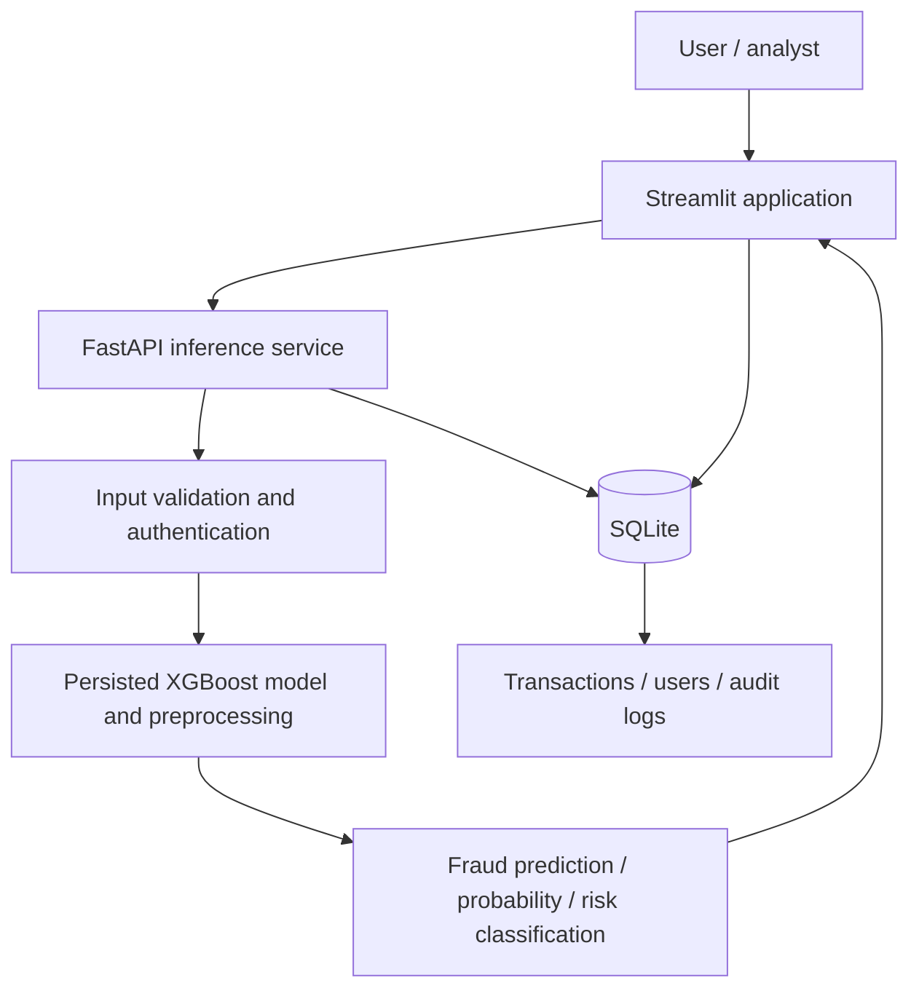

# FraudGuard AI — Engineering Architecture

**Status:** Functional machine-learning application; ongoing validation. Offline metrics are not production guarantees.

## System overview



## Responsibilities

| Component | Documented responsibility |
|---|---|
| Streamlit | Authentication, transaction analysis, monitoring and review interface |
| FastAPI | Request validation, authenticated inference and API integration |
| ML artifacts | Trained classifier and supporting feature transformations |
| SQLite | Transaction records, user data and audit events |
| Role-based access | Different capabilities for admin, analyst and user roles |

## Model development and evaluation

The repository documents data cleaning, feature engineering, class-imbalance handling, model comparison, tuning and model persistence. It identifies **XGBoost** as the application model.

**Evaluation caution:** the README includes near-perfect development metrics and separately reported temporal test results. These should not be presented as interchangeable, nor interpreted as production fraud-prevention effectiveness. Model validation should document split strategy, class prevalence, leakage checks, precision-recall trade-offs, threshold selection and performance on genuinely unseen periods.

## Security and privacy boundaries

- Passwords are documented as bcrypt-hashed.
- Public registration is limited to the standard user role.
- Audit events are stored for operational traceability.
- The presence of authentication and audit logs does **not** establish a completed security audit.
- Do not commit API keys, personal financial records or production transaction data.

## Local development

Follow the repository README and `.env.example`. Its documented startup sequence is:

```bash
pip install -r requirements.txt
uvicorn api.api:app --host 0.0.0.0 --port 8001
```

In a second terminal:

```bash
streamlit run app.py
```

Check configuration and model-artifact availability before starting.

## Next engineering validation milestones

1. Reproduce evaluation on a documented time-based holdout.
2. Inspect feature provenance and potential target leakage.
3. Record threshold-specific precision, recall and false-alert burden.
4. Test inference input validation, authorization and audit events.
5. Add representative, redacted application screenshots and verified CI badges.
6. Evaluate drift and monitoring requirements before any production claims.

This architecture note describes the repository-documented design; it is not a third-party audit.
